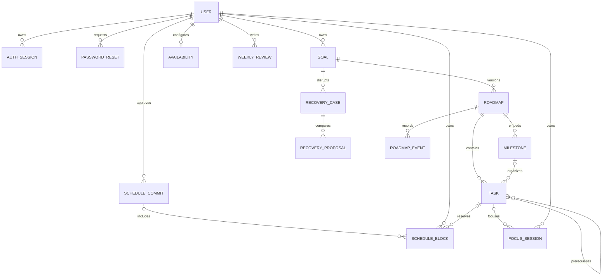

# CircleUp backend

The Express modular monolith uses the existing `/api` paths and MongoDB ObjectIds. The Next.js frontend proxies the owned routes and keeps the JWT in an HttpOnly cookie. See the [initial audit](BACKEND-AUDIT.md) and [OpenAPI operation and request reference](openapi.yaml).

## Local development

From the outer Heypal folder in PowerShell, run `cd .\hey-pal\backend`. Copy `.env.example` to `.env` and set a unique random JWT secret. Run `npm.cmd ci`. Use either a local replica set with `npm.cmd run dev` or `docker compose up --build`. The Compose example binds both services to loopback and is for local development. Atlas or another reachable replica set can be configured through `MONGODB_URI`. The frontend runs separately from `hey-pal\frontend`.

`GET /api/health` checks that the process responds. `GET /api/ready` reports the database connection state. Startup validates environment fields and rejects a standalone MongoDB topology. Local API calls use the configured port, 5000 by default.

## HTTP and storage implementation

| Module and source | Implemented API and changes | Success fields |
| --- | --- | --- |
| Auth, `modules/auth`, `authController`, `protect` | Register, login, current user, logout and reset request/completion. Session and reset token TTL indexes. New sessions are revocable and account state is checked. | `user` and `token` on sign-in, `user` on /me |
| Goals, `goalController` and `Goal` | Owned CRUD and explicit archive. Deletes tasks and archives roadmap versions transactionally. Adds motivation and priority plus owned status and date indexes. | `goal`, `goals`, `count` |
| Roadmaps and milestones, `roadmapController`, `Roadmap` | Version list, draft creation and editing, validation, explicit approval, ordered milestone CRUD through the roadmap milestones array, and archive. Legacy active creation is retained as an approved submission. Both activation paths serialize supersession and record events. | `roadmap`, `roadmaps`, `milestones`, `valid`, `warnings` |
| Tasks, `taskController`, `modules/tasks`, `Task` | Owned CRUD, completion, prerequisite checks and cycle rejection. Version increments on task edits. Validates optional milestone references, cleans dependencies on deletion and cancels planned reservations. | `task`, `tasks`, `count` |
| Planner, `modules/planning` | IANA weekly availability, closed dates, timed reservations, interval capacity, preview and idempotent single or batch commit. Initial availability and reservations are persistent. | `availability`, `block`, `blocks`, `intervals`, `availableMinutes` |
| Recovery, `modules/recovery` | Detects missed work on an active roadmap, generates three immutable alternatives, saves history, rejects cases, and approves feasible proposals atomically. Approval verifies fingerprint, expiry, active version and future slots before mutating. | `recoveryCase`, `proposals`, `proposal`, `roadmap`, `cases`, `nextCursor` |
| Focus, `modules/progress/focus` | Persisted start, pause, resume, completion, interruption and paginated history. Server timestamps, request keys and revisions prevent duplicate elapsed seconds. | `session`, `sessions`, `nextCursor` |
| Analytics and reviews, `modules/progress/routes` | Data-backed goal progress, workload, actual focus, overdue work, recovery outcomes and persistent weekly review reads and writes. | `goal`, `taskCounts`, `milestones`, summary metrics, `review`, `reviews`, `nextCursor` |

All successful operations return `success: true`. Legacy list calls retain their original unpaginated behavior and can opt into a bounded page via limit and before. New history queries use bounded pages and cursor parameters. The API preserves the legacy task status vocabulary and stores dependencies in the authoritative Task document. Milestones remain embedded in a capped roadmap array to preserve current IDs and compatibility. The array order represents milestone order. Milestone completion is explicit outcome evidence. Focus time does not complete tasks.

## Relationships

Hard goal deletion removes operational tasks, cleans dependency references, and cancels planned task bookings. Accepted roadmaps, recovery history, and historical focus/activity records remain as owned audit history. Draft deletion removes its tasks. Deleting accepted versions archives them. Planned schedule blocks can be cancelled. Completed blocks and past focus records remain evidence.

## Scheduling and recovery rules

- Bookings are half-open UTC intervals. Availability rules use IANA local time and real UTC minutes, so DST gaps contribute zero elapsed time and repeated local minutes represent distinct instants. Fixed commitments and breaks block intervals even outside working windows.
- The account document is updated first inside each coordinated transaction. The shared write serializes roadmap, task, availability, reservation, and recovery mutations across API processes. Transactions require primary access. External database writers must use the same protocol or be disabled.
- Recovery considers a 14-day horizon and gives the user 30 minutes before the first proposed block starts. Deterministic greedy scheduling places whole tasks by prerequisites, deadline, priority and ID. Existing reservations, downstream booked work and goal deadlines are constraints. The engine may decline a plan that requires splitting tasks or a non-greedy reorder.
- A date-only goal or milestone is inclusive in the configured local timezone. Protect Deadline keeps essential work and its prerequisite closure. Optional work outside that proposal retains its state for separate planning. Redistribute tries every detected task. Revise Milestone may extend one shared, dated, incomplete milestone within the goal and explicit task deadlines.
- Approval writes the replacement roadmap, reservations, task updates, proposal state and an audit event together. Completed and cancelled tasks remain associated with their historical roadmap. Repeating an approved proposal ID returns its recorded result. Regenerate after a stale response.
- Weekly summaries count tasks with server-recorded completion within the local week, clipped duration of non-cancelled task reservations, and recorded seconds from focus sessions completed during the week. Date-only scheduled tasks are grouped by calendar label. Case outcomes are grouped by current state for cases opened that week.

## Indexes and scaling

Goal lists, date filters, owner-scoped task status and due dates, unique goal/version, milestone references, reservation time ranges, lifecycle history, and unique user/week reviews have declared indexes. The active version invariant uses the account transaction guard. Interval overlap is checked with indexed candidate selection and in-memory comparisons. Dependency validation reads the goal graph and traverses reachable edges in O(V + E). The recovery calendar scan is linear in bounded UTC minutes plus sorted reservations. The greedy scheduler may scan the remaining task and slot sets for each placed task.

## Deployment and security review

- Create separate staging and production databases, secrets and reset delivery endpoints. Set a production HTTPS `CLIENT_URL`, configure HTTPS termination, and keep Express behind the gateway. Size rate limits against deployment traffic. The included rate limits are process-local. Behind the Next.js proxy, upstream limits can be shared by traffic from that proxy.
- Set `REQUIRE_MANAGED_SESSIONS=true` before rollout to reject legacy stateless JWTs and require users with old sessions to sign in again. Production enables this by default. Development can temporarily accept legacy tokens until their signed expiry. Password resets revoke managed sessions and recheck the credential stamp against concurrent logins.
- Reset delivery requires both `PASSWORD_RESET_WEBHOOK` and `PASSWORD_RESET_WEBHOOK_SECRET`. The trusted HTTPS endpoint receives the email, single-use token and expiry in a JSON request authenticated by the independent webhook secret. Construct the frontend link as `/reset-password#token=<token>`. Keep webhook requests and URLs out of logs. The application stores a hash of each token and removes all outstanding tokens after successful consumption.
- Application logs include a request ID, method, status and duration, with credential fields excluded. Forward logs to the deployment monitor and alert on readiness failures, error rates, and transaction conflicts. Validate gateway configuration and reset delivery in staging.
- Enable encrypted database backups and point-in-time recovery. Practice restores only to an isolated replica set, check indexes and record counts, then exercise login and an approval before any traffic switch. For rollback, retain the previous image, pause writes for schema-sensitive changes and verify older readers can tolerate additional lifecycle statuses. Use a reviewed database restore plan for incompatible changes.
- Circles, memberships, explicit shares and promises are deferred until release approval. A production rollout also needs an approved privacy retention/export/deletion policy, external security review, monitoring and backup restore verification. The included CI job performs verification and contains no deployment step.

## Verification

Run `npm run build` and `node --test "dist/**/*.test.js"` in the backend. Set `CIRCLEUP_TEST_MONGO_URI` to an isolated test replica set to include HTTP and transaction integration checks. The suite creates a uniquely named disposable test database. The Windows verification used a local loopback-only MongoDB replica set. See the final recorded results below.

The final backend run passed all 19 tests, including the real replica-set HTTP workflow. It exercised authentication and ownership, one-time password reset with a mocked delivery webhook, session revocation, draft approval, DAG validation, competing reservations, atomic batch commit and replay, stale and rejected recovery, injected transaction rollback, duplicate approval, focus transitions, and weekly summaries. The built server also passed live startup, liveness, and readiness probes.

The loopback read workload measured p95 at 160.4 ms across 24 sequential authenticated task-list and summary requests with 250 additional synthetic tasks. A forced date-index explain examined 251 keys for 251 records. This is a local baseline. Production concurrency, provider delivery, and backup restore remain unverified. OpenAPI, Compose, and CI configuration parsed successfully. Docker execution and hosted CI remain unverified.

The frontend production build, ESLint, five frontend unit tests, and six browser tests passed. Browser coverage includes the same-origin proxy, recovery approval, persisted focus transitions and weekly review reloads through a contract fixture. The backend suite independently used live MongoDB.
